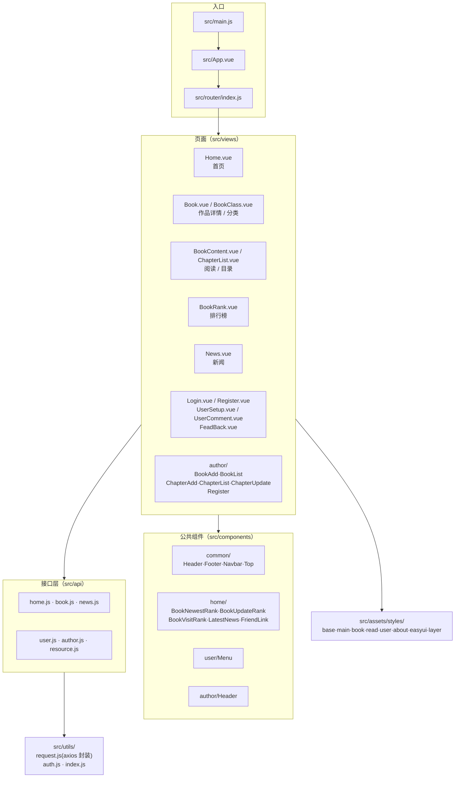

# novel-front-web：Vue 3 小说门户与作家专区前端（上游副本）

**本仓库是开源项目 [novel-front-web](https://github.com/201206030/novel-front-web) 前端工程的副本，不是原创作品。** 原项目由 **201206030** / **novel_dev_team** 开发并开源，遵循 Apache License 2.0，代码与设计版权归原作者所有。此处仅用于学习与本地运行，未主张任何原创权利。

本仓库是 `novel` 体系的**浏览器端**，对应小说门户前台（读者端）+ 作家专区；数据全部来自后端 HTTP 接口，**无法独立运行出内容**。

| 角色 | 仓库 |
|---|---|
| 前端（本仓库，Vue 3） | https://github.com/DLDLDL13579/novel-front-web |
| 后端（Spring Boot 3 + Java 21） | https://github.com/DLDLDL13579/novel |
| 上游前端原版 | https://github.com/201206030/novel-front-web ｜ https://gitee.com/novel_dev_team/novel-front-web |
| 上游后端原版 | https://github.com/201206030/novel ｜ https://gitee.com/novel_dev_team/novel |
| 上游线上应用版 / 微服务版 | https://github.com/201206030/novel-plus ｜ https://github.com/201206030/novel-cloud |
| 上游配套教程 | https://docs.xxyopen.com/course/novel |

上游 `novel` 是**教学示例项目**，覆盖小说推荐、作品检索、排行榜、阅读、评论、会员中心、作家专区、充值订阅、新闻发布等。本副本能确认的前端范围是文件树中列出的 `src/views/`（读者端 12 个 + 作家端 6 个）与 `src/api/`（6 个业务域），**未见平台后台管理页面**，详见「已知问题」。

---

## 现状与状态表

| 项 | 事实 | 出处 |
|---|---|---|
| 仓库 | `DLDLDL13579/novel-front-web`，公开，默认分支 `master` | GitHub API 元数据 |
| 主语言 / 体积 | Vue / 726 KB | GitHub API 元数据 |
| star / fork | 1 / 0 | GitHub API 元数据 |
| 创建 / 最后 push | 2025-05-27 / 2026-09-17 | GitHub API 元数据 |
| GitHub 描述 | 空 | GitHub API 元数据 |
| 文件规模 | 84 个文件：`src` 70、根文件 11、`public` 3 | 真实文件树（git/trees?recursive=1） |
| 工程坐标 | `novel-front-web@3.4.0`，`private: true` | `package.json` |
| 当前基线 | Vue CLI 5 + Vue 3.2.x + Vue Router 4 + axios 0.27 | `package.json` |
| 已完成 | 路由表、业务域 API 封装、axios 实例、登录态工具、公共/首页/用户/作家组件、8 份 CSS、开发服务器与构建脚本 | 文件树 + `package.json` |
| 未完成 / 待配置 | 后端接口 `baseURL` 需按部署环境设置；无 `engines` 字段、Node 版本仅见上游声明；无测试脚本 | `package.json` + 现有 README |
| LICENSE | **Apache License 2.0**（根目录有 `LICENSE`，原文为完整 Apache-2.0 条款） | GitHub API 元数据 + `LICENSE` 原文 |
| 定位 | 第三方副本 + 学习用途，非商业产品 | 上游项目定位 |

> **重要说明**：事实包的文件树是**节选**——共 84 个文件只逐条列出 57 个（`src` 70 个中列出 49 个，`public` 3 个中列出 1 个，根文件 11 个中列出 7 个）。因此下文凡现有 README 记载、但节选未列出的文件（如 `src/assets/images/`、`yarn.lock`、`public/favicon.ico`、`public/default.gif`），一律标注为「未复核」，**不据此断言文件不存在**。

---

## 技术栈

版本逐字取自 `package.json`。

| 技术 | 版本 | 说明 |
|---|---|---|
| Vue.js | `^3.2.13` | 渐进式 JavaScript 框架 |
| Vue Router | `^4.0.15` | 官方路由 |
| axios | `^0.27.2` | 基于 Promise 的 HTTP 请求库 |
| element-plus | `^2.2.0` | Vue 3 组件库 |
| jQuery | `^3.6.0` | 通过 `webpack.ProvidePlugin` 全局注入 |
| core-js | `^3.8.3` | polyfill |
| 构建 | `@vue/cli-service` `~5.0.0`（含 `@vue/cli-plugin-babel`、`@vue/cli-plugin-eslint`） | Vue CLI 5 |
| Babel | `@babel/core` `^7.12.16`、`@babel/eslint-parser` `^7.12.16` | 转译与 lint parser |
| 代码检查 | `eslint` `^7.32.0`、`eslint-plugin-vue` `^8.0.3` | `plugin:vue/vue3-essential` + `eslint:recommended` |
| 目标浏览器 | `> 1%`, `last 2 versions`, `not dead`, `not ie 11` | `browserslist` |

`package.json` 的 `version` 为 **3.4.0**，`private: true`（不会发布到 npm）。脚本只有三个：

```json
"scripts": {
  "serve": "vue-cli-service serve",
  "build": "vue-cli-service build",
  "lint": "vue-cli-service lint"
}
```

**没有 `test` 脚本，也没有任何测试框架依赖**（`devDependencies` 只有 8 个构建/lint 相关包）。

---

## 前端架构



页面 → 组件 → API → axios 封装的四层是单向依赖：`views/` 不直接碰 axios 实例，`api/` 按业务域（首页、作品、新闻、用户、作家、资源）拆成 6 个文件，统一的拦截器/基础地址放在 `utils/request.js`（该文件的具体 `baseURL` 与拦截器内容本次事实包未收录原文，不能逐字引用）。`utils/auth.js` 管登录态，`utils/index.js` 放通用函数。

### 接口分层与页面清单

| 分组 | 文件 | 面向 |
|---|---|---|
| `src/api/` | `home.js`、`book.js`、`news.js`、`user.js`、`author.js`、`resource.js` | 6 个业务域 |
| `src/views/` 读者端 | `Home.vue`、`Book.vue`、`BookClass.vue`、`BookContent.vue`、`BookRank.vue`、`ChapterList.vue`、`News.vue`、`Login.vue`、`Register.vue`、`UserSetup.vue`、`UserComment.vue`、`FeadBack.vue` | 门户 / 阅读 / 用户中心（共 12 个） |
| `src/views/author/` | `Register.vue`、`BookAdd.vue`、`BookList.vue`、`ChapterAdd.vue`、`ChapterList.vue`、`ChapterUpdate.vue` | 作家专区（共 6 个） |
| `src/components/common/` | `Header.vue`、`Footer.vue`、`Navbar.vue`、`Top.vue` | 全站框架 |
| `src/components/home/` | `BookNewestRank.vue`、`BookUpdateRank.vue`、`BookVisitRank.vue`、`FriendLink.vue`、`LatestNews.vue` | 首页榜单与新闻区块 |
| `src/components/user/` | `Menu.vue` | 用户中心侧栏 |
| `src/components/author/` | `Header.vue` | 作家专区页头 |
| `src/assets/styles/` | `about.css`、`base.css`、`book.css`、`easyui.css`、`layer.css`、`main.css`、`read.css`、`user.css` | 8 份按页面拆分的样式 |

> `FeadBack.vue` 是上游原项目的拼写（正确英文应为 `Feedback`），改文件名会连带改路由与引用，属上游遗留，本副本原样保留（现有 README 已注明）。

---

## 目录结构

以下路径来自事实包的真实文件树节选；标注「现有 README 记载」的条目本次未逐字复核。

```
novel-front-web/
├── public/
│   └── index.html                 # HTML 模板（节选中唯一列出的 public 文件）
│   ├── favicon.ico                # 现有 README 记载，节选未列出（未复核）
│   └── default.gif                # 现有 README 记载，节选未列出（未复核）
├── src/
│   ├── main.js                    # 应用入口
│   ├── App.vue                    # 根组件
│   ├── api/                       # 接口封装（按业务域拆分）
│   │   └── author.js  book.js  home.js  news.js  resource.js  user.js
│   ├── router/index.js            # 路由表
│   ├── utils/
│   │   ├── request.js             # axios 实例封装
│   │   ├── auth.js                # 登录态处理
│   │   └── index.js               # 通用工具
│   ├── components/
│   │   ├── common/  Header.vue  Footer.vue  Navbar.vue  Top.vue
│   │   ├── home/    BookNewestRank.vue  BookUpdateRank.vue  BookVisitRank.vue
│   │   │            FriendLink.vue  LatestNews.vue
│   │   ├── user/    Menu.vue
│   │   └── author/  Header.vue
│   ├── views/
│   │   ├── Home.vue  Book.vue  BookClass.vue  BookContent.vue
│   │   ├── BookRank.vue  ChapterList.vue  News.vue
│   │   ├── Login.vue  Register.vue  UserSetup.vue  UserComment.vue
│   │   ├── FeadBack.vue           # 上游拼写，非笔误修正对象
│   │   └── author/  Register.vue  BookAdd.vue  BookList.vue
│   │                ChapterAdd.vue  ChapterList.vue  ChapterUpdate.vue
│   └── assets/
│       ├── styles/                # about/base/book/easyui/layer/main/read/user.css（8 个）
│       └── images/                # 现有 README 记载，节选未列出（未复核）
├── vue.config.js                  # 开发服务器、webpack 插件
├── babel.config.js                # Babel 配置（节选列出，原文未收录）
├── jsconfig.json                  # 编辑器路径别名 @/*
├── package.json                   # 依赖与三个脚本
├── .gitignore
├── LICENSE                        # Apache License 2.0 全文
├── README.md
└── yarn.lock                      # 现有 README 记载，节选未列出（未复核）
```

---

## 关键实现

### 为什么全局注入 jQuery

`vue.config.js` 全文（逐字）：

```js
const { defineConfig } = require('@vue/cli-service')
const webpack = require("webpack");
module.exports = defineConfig({
  devServer:{
    // 端口号的配置
		port:1024  
	},
  transpileDependencies: true,
  lintOnSave: false,
  configureWebpack: {
    plugins: [
        new webpack.ProvidePlugin({
            $:"jquery",
            jQuery:"jquery",
            "windows.jQuery":"jquery"
        })
    ]
  }
})
```

`webpack.ProvidePlugin` 会在**每个模块**里遇到自由变量 `$`、`jQuery` 时自动 `require('jquery')`，这样从传统 jQuery 页面迁移过来的组件不必逐个写 `import $ from 'jquery'` 也能跑。这是兼容旧代码而非新代码推荐写法，代价是 jQuery 会被打进多个 chunk 的引用图。注意它注入了**三个**标识符（现有 README 只提到 `$` / `jQuery`）：第三个键是字符串 `"windows.jQuery"`（字面如此，不是 `window.jQuery`），按 webpack 语义它匹配的是一个名为 `windows.jQuery` 的标识符，实际几乎不会命中，属无效/笔误配置，见「已知问题」。

`transpileDependencies: true` 让 `node_modules` 里的依赖也过 Babel，配合 `target: es5` / `not ie 11` 的浏览器目标；`lintOnSave: false` 表示开发时保存文件不触发 lint，只有手动 `yarn lint` 才检查。

### 路径别名

`jsconfig.json` 全文（逐字）：

```json
{
  "compilerOptions": {
    "target": "es5",
    "module": "esnext",
    "baseUrl": "./",
    "moduleResolution": "node",
    "paths": {
      "@/*": [
        "src/*"
      ]
    },
    "lib": ["esnext", "dom", "dom.iterable", "scripthost"]
  }
}
```

`@/* → src/*` 供编辑器（VS Code / WebStorm）解析跳转；Vue CLI 5 内部同样默认提供 `@` 指向 `src`，两者一致。`target: es5` 只是编辑器的语言服务提示，实际转译结果由 Babel + `browserslist` 决定。

### HTML 模板

`public/index.html` 全文（逐字）：

```html
<!DOCTYPE html>
<html lang="">
  <head>
    <meta charset="utf-8">
    <meta http-equiv="X-UA-Compatible" content="IE=edge">
    <meta name="viewport" content="width=device-width,initial-scale=1.0">
    <link rel="icon" href="<%= BASE_URL %>favicon.ico">
    <title><%= htmlWebpackPlugin.options.title %></title>
  </head>
  <body>
    <noscript>
      <strong>We're sorry but <%= htmlWebpackPlugin.options.title %> doesn't work properly without JavaScript enabled. Please enable it to continue.</strong>
    </noscript>
    <div id="app"></div>
    <!-- built files will be auto injected -->
  </body>
</html>
```

模板引用 `<%= BASE_URL %>favicon.ico`，说明 `public/favicon.ico` 应当存在（现有 README 也这么写），但事实包节选未列出该文件，若缺失浏览器只会报一个 404，不影响构建。`title` 取的是 `htmlWebpackPlugin.options.title`，而 `vue.config.js` 中没有显式设置 title，实际显示值取决于 Vue CLI 的默认行为，需以构建产物为准，不在本 README 里臆测。

### ESLint 配置内嵌在 package.json

```json
"eslintConfig": {
  "root": true,
  "env": { "node": true },
  "extends": ["plugin:vue/vue3-essential", "eslint:recommended"],
  "parserOptions": { "parser": "@babel/eslint-parser" },
  "rules": {}
}
```

没有独立的 `.eslintrc*`（节选中未出现），规则集为 Vue 3 基础规则 + ESLint 推荐，`rules` 为空说明完全沿用上游默认，不做项目级覆盖。

---

## 参数表

| 配置项 | 值 | 出处 |
|---|---|---|
| `devServer.port` | **1024** | `vue.config.js` |
| `transpileDependencies` | `true` | `vue.config.js` |
| `lintOnSave` | `false` | `vue.config.js` |
| `configureWebpack.plugins` | `new webpack.ProvidePlugin({ $, jQuery, "windows.jQuery" })` | `vue.config.js` |
| `name` | `novel-front-web` | `package.json` |
| `version` | `3.4.0` | `package.json` |
| `private` | `true` | `package.json` |
| `scripts.serve` | `vue-cli-service serve` | `package.json` |
| `scripts.build` | `vue-cli-service build` | `package.json` |
| `scripts.lint` | `vue-cli-service lint` | `package.json` |
| 路径别名 | `@/*` → `src/*` | `jsconfig.json` |
| `compilerOptions.target` / `module` | `es5` / `esnext` | `jsconfig.json` |
| `browserslist` | `> 1%`、`last 2 versions`、`not dead`、`not ie 11` | `package.json` |
| `link[rel=icon]` | `<%= BASE_URL %>favicon.ico` | `public/index.html` |
| 挂载点 | `<div id="app"></div>` | `public/index.html` |

> 后端端口与 CORS 白名单定义在另一个仓库 `novel` 的 `src/main/resources/application.yml`（详见该仓库 README 的参数表）。本前端仓库**没有** `.env` 文件，且 `vue.config.js` 全文没有 `devServer.proxy` 配置，所以 axios 的 `baseURL` 必须写成完整的后端地址；具体字符串在 `src/utils/request.js`，本次事实包未收录该文件的原文，请到源码中确认，不要照抄任何示例地址。

---

## 快速开始

**前置条件**：

- Node.js —— 现有 README 记载为 **16.14**（标注为「原项目声明版本」）；`package.json` 中**没有 `engines` 字段**，因此该版本不是由代码强制约束的，Vue CLI 5 实际可运行的 Node 范围请以本机安装结果为准。
- 一个可用的 `novel` 后端服务（仓库 https://github.com/DLDLDL13579/novel ），以及其依赖的 MySQL 与 Redis。
- 包管理器：`yarn` 或 `npm` 均可（`package.json` 未锁定管理器）。

```bash
git clone https://github.com/DLDLDL13579/novel-front-web.git
cd novel-front-web

# 1. 安装依赖
yarn install          # 或 npm install

# 2. 先确认后端地址
#    打开 src/utils/request.js，把 axios 的 baseURL 改成后端实际地址
#    （后端端口见 novel 仓库的 application.yml；本仓库未配置 devServer.proxy）

# 3. 启动开发服务器
yarn serve            # 默认 http://localhost:1024

# 4. 生产构建 / 代码检查
yarn build            # 产物在 dist/（.gitignore 已忽略）
yarn lint
```

`npm` 等价命令：`npm install`、`npm run serve`、`npm run build`、`npm run lint`。

后端需自行启动（见 https://github.com/DLDLDL13579/novel 的 README），并确认其 CORS 白名单包含本前端的开发来源 `http://localhost:1024`。

---

## 已知问题

| # | 问题 | 依据 / 影响 |
|---|---|---|
| 1 | **文档描述落后于代码：平台后台管理前端不存在** | 现有 README 称整个 `novel` 体系「由小说门户系统、作家后台管理系统、平台后台管理系统等子系统构成」，但本副本 `src/views/` 只有读者端 12 个页面 + `author/` 6 个页面，没有 admin 相关目录或组件。本仓库只覆盖门户前台与作家专区，不提供平台后台。 |
| 2 | **`"windows.jQuery": "jquery"` 是无效注入** | `vue.config.js` 的 `ProvidePlugin` 第三个键写成 `windows.jQuery`（复数 + 点号字符串），按 webpack 语义匹配的是字面标识符 `windows.jQuery`，日常代码里几乎不会出现；若本意是挂到全局 `window`，写法也不对。现有 README 的构建配置表只列了 `$` / `jQuery` 两项，漏了这一处。 |
| 3 | **前端未配置代理，后端地址需改源码** | `vue.config.js` 没有 `devServer.proxy`，文件树节选中也没有 `.env*` 文件。换部署环境必须改 `src/utils/request.js`（该文件的 `baseURL` 原文本次事实包未收录，不臆测其写法）并重新构建；不存在通过环境变量切换后端的机制。 |
| 4 | **文件树节选与现有 README 的目录结构不完全对应** | 现有 README 列出 `src/assets/images/`、`yarn.lock`、`public/favicon.ico`、`public/default.gif`，本次节选未逐条列出这些路径；文件树一级分布写的是 `src:70` / `public:3` / 根文件 `11`，说明还有未列出的文件。**不能据此判定文件缺失**，需在仓库内复核；若 `favicon.ico` 确实缺失，`public/index.html` 的图标引用会 404。 |
| 5 | **第三方品牌图片素材的权属未随仓库附带** | 现有 README 记载 `src/assets/images/` 含 `login_qq.png`、`login_weibo.png`、`login_weixin.png`、`pay_wx.png`、`pay_zfb.png`。这些图标版权归对应平台/品牌方，Apache-2.0 不覆盖第三方素材；对外分发前需单独确认授权或替换。 |
| 6 | **无 `engines`、无 `test` 脚本、无测试依赖** | `package.json` 未声明 Node 版本约束，`16.14` 只来自上游文档；没有 `test` 脚本，也没有 jest/vitest 等依赖，因此「`yarn test`」不可用，改动只能靠 `yarn lint` + 手工验证。 |
| 7 | **`lintOnSave: false` + `rules: {}`** | 开发时保存不触发 lint，且没有任何项目级规则覆盖；`yarn lint` 只跑 Vue 3 essential + ESLint recommended，容易漏掉问题。 |
| 8 | **依赖版本范围宽松，无锁文件确认** | 全部依赖用 `^` / `~` 范围（`^3.2.13`、`~5.0.0` 等），而 `yarn.lock` 是否在仓库里未在节选中确认。若无锁文件，不同时间 `yarn install` 得到的构建结果可能不同，Vue CLI 5 + ESLint 7 的组合在新版 Node 上也容易出兼容问题。 |
| 9 | **`FeadBack.vue` 拼写遗留** | 现有 README 已注明是上游原项目拼写。它与 `src/router/index.js` 的引用绑定，重命名需同步改路由，不建议在本副本单独「修正」。 |
| 10 | **Vue 3 + jQuery + element-plus 混用** | `package.json` 同时依赖 `vue ^3.2.13`、`element-plus ^2.2.0` 与 `jquery ^3.6.0`，并由 `ProvidePlugin` 全局注入 jQuery；8 份 `src/assets/styles/` 中含 `easyui.css`、`layer.css` 这类传统 jQuery 插件的样式。混用会让 DOM 归属不清，改造时容易踩「Vue 接管后 jQuery 手动改 DOM 被覆盖」的问题。 |
| 11 | **前端 README 未覆盖后端 CORS 与版本对应关系** | 后端 `novel` 的白名单与端口定义在其 `application.yml` 中，本仓库既无代理配置也无 `.env` 覆盖，跨仓联调时必须同时核对两端配置；两份 README 的版本声明（后端 `3.5.1-SNAPSHOT`、前端 `3.4.0`）也不一致，属上游不同发布节奏，不代表接口不兼容。 |
| 12 | **HTML 模板 title 未在 `vue.config.js` 显式设置** | `public/index.html` 用 `<%= htmlWebpackPlugin.options.title %>`，而 `vue.config.js` 全文没有 `pages` 或 title 覆盖，标题实际取值需看构建产物；不排除显示为空或包名。 |
| 13 | **本仓库是副本，不接收特性修复** | 上游在 https://github.com/201206030/novel-front-web ，修复应优先提给上游；本副本的任何本地改动在同步上游时会冲突。 |

---

## 归属与许可证

### 上游项目

| 项 | 内容 |
|---|---|
| 项目 | **novel** —— 前后端分离学习型小说系统 |
| 作者 / 组织 | **201206030**（GitHub） / **novel_dev_team**（Gitee） |
| 前端仓库 | https://github.com/201206030/novel-front-web ｜ https://gitee.com/novel_dev_team/novel-front-web |
| 后端仓库 | https://github.com/201206030/novel ｜ https://gitee.com/novel_dev_team/novel |
| 线上应用版 / 微服务版 | https://github.com/201206030/novel-plus ｜ https://github.com/201206030/novel-cloud |
| 配套教程 | https://docs.xxyopen.com/course/novel |
| 许可证 | **Apache License 2.0**（本仓库根目录 `LICENSE` 为完整 Apache-2.0 条款） |

### 本仓库说明

- 本仓库是上述**上游前端工程**的副本，保留原始 `LICENSE` 与原作者署名，**未主张任何原创权利**；代码、设计与目录组织均来自上游（含 `FeadBack.vue` 这类原样保留的拼写）。
- 依据 Apache-2.0，可自由使用、修改与再分发，但须保留版权声明与许可证文本，且不得使用原作者名义为衍生作品背书。
- 本项目为**学习用途**，上游作者亦将其定位为教学示例项目，不提供任何可用性保证。
- `src/assets/images/` 中的图片素材（现有 README 记载含第三方登录图标 `login_qq.png`、`login_weibo.png`、`login_weixin.png`，支付图标 `pay_wx.png`、`pay_zfb.png`）版权归对应平台 / 品牌方所有，此处仅为演示引用，不在 Apache-2.0 授权范围内。
- 后端配套见 https://github.com/DLDLDL13579/novel 。
